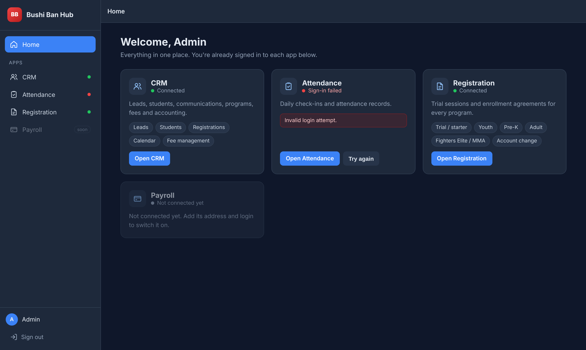
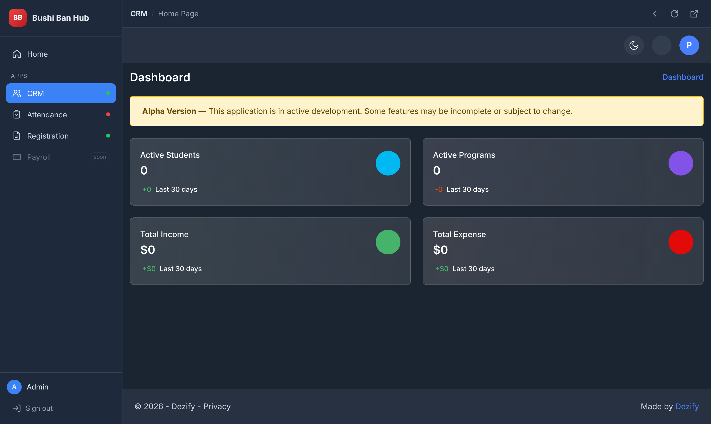

# Bushi Ban Hub

One website, one sign-in, for the three Bushi Ban apps:

| App | Address | What it covers |
| --- | --- | --- |
| CRM | `dezify.bestautomation.top` | Leads, students, messages, programs, fees, accounting |
| Attendance | `dezify.attendance.bestautomation.top` | Check-ins and attendance records |
| Registration | `dezify.registration.bestautomation.top` | Trial sessions and enrollment agreements |

Payroll has a placeholder in the sidebar. Turn it on by adding its address and login to `config.json`.




## How it works

The three apps refuse to be shown inside another site (they send `X-Frame-Options: DENY`). Each one also has its own login. The hub gets around both:

1. **You sign in once, to the hub.**
2. **The hub signs in to each app for you** on the server, using the app logins stored in `config.json`. The browser never sees those passwords or the apps' session cookies.
3. **Each app is passed through the hub on its own port** (3001, 3002, 3003). On the way through, the hub removes the "don't embed me" header, so every app can sit inside the hub's sidebar layout.
4. **If an app session expires, the hub signs in again.** Pressing an app's own "Log out" button signs you out of the hub.

Other details:

- The address bar keeps track of where you are, like `#/crm/Leads`, so you can bookmark pages and refresh without losing your place.
- The top bar has **Back**, **Reload** and **Open in new tab** buttons.
- The home page shows whether each app is connected. If a sign-in fails, it shows the app's error message.

No app code was changed. The hub works with the apps exactly as they are.

## Run it

Needs Node.js 20 or newer. There's nothing to install.

```bash
cd dezify-hub
cp config.example.json config.json   # then fill in the app logins
npm start
```

Open http://localhost:3000 and sign in as `admin` / `change-me`. Change this login in `config.json`.

`config.json` is gitignored, so credentials never get committed.

## Configuration (`config.json`)

| Key | What it does |
| --- | --- |
| `users` | Who can sign in to the hub. Use `passwordHash` instead of `password` outside development. Create one with `npm run hash-password -- "the password"`. |
| `users[].appCredentials` | Optional. Gives one hub user their own login for an app, e.g. `{ "crm": { "email": "...", "password": "..." } }`. Otherwise the app's shared `credentials` are used. |
| `apps[].credentials` | The login the hub uses for that app. |
| `apps[].shortcuts` | Quick links shown on the home page. |
| `apps[].enabled` | Set to `false` to show an app as "soon" without connecting it. |
| `host` | `127.0.0.1` by default, so only this computer can reach the hub. Use `0.0.0.0` to allow other devices on the network. |

### Adding Payroll (or any other app)

Fill in the `payroll` entry: `upstream` (its address), `credentials`, and `"enabled": true`. Then restart. Any app that uses the standard ASP.NET Core Identity login page works without changes. If an app's login form uses different field names, set them in `login`.

## Putting it online later

Put the hub behind a web server with HTTPS (Caddy or nginx). Give each app its own subdomain, then point the hub at those subdomains in the config:

```
hub.example.com           -> localhost:3000
crm.hub.example.com       -> localhost:3001
attendance.hub.example.com-> localhost:3002
register.hub.example.com  -> localhost:3003
```

Then set these keys in `config.json`:

- `hubPublicUrl`: `https://hub.example.com`
- `apps[].publicUrl` for each app, e.g. `https://crm.hub.example.com`
- `cookieDomain`: `.hub.example.com`
- `secureCookies`: `true`
- `trustProxy`: `true`

## Good to know

- **Everyone shares the same app accounts unless you change that.** If several staff use the hub with the shared logins, the CRM will record all of their actions under one CRM account. Use `users[].appCredentials` to give each person their own app login.
- **Restarting the hub signs everyone out.** Hub sessions are kept in memory, which is fine for development.
- **A real single sign-on is the long-term fix.** The apps' own developers would need to make them share one login, for example a shared ASP.NET Identity cookie across `*.bestautomation.top`. Once that's done, the hub wouldn't need to store any app passwords.
